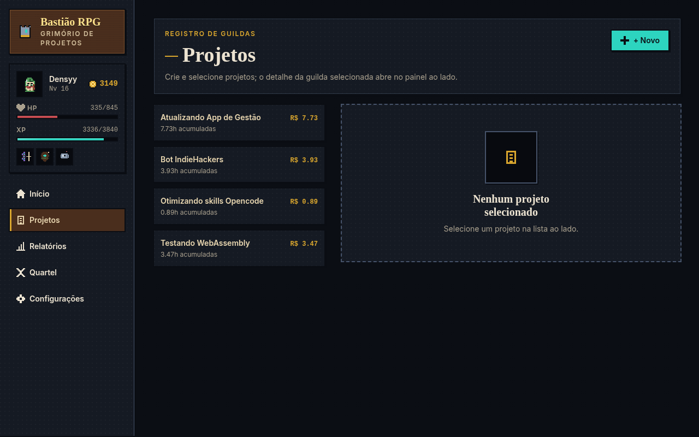
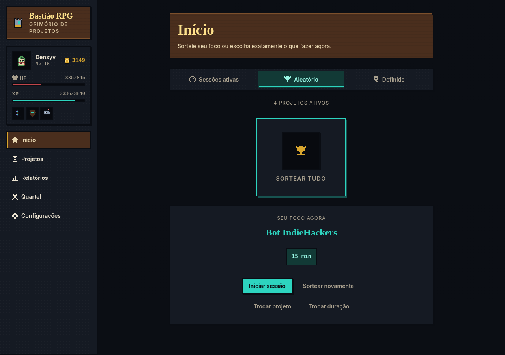
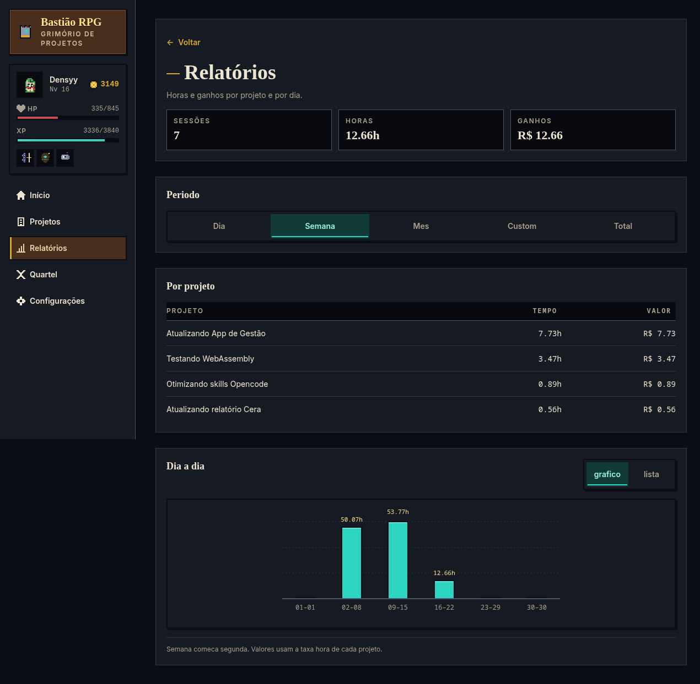
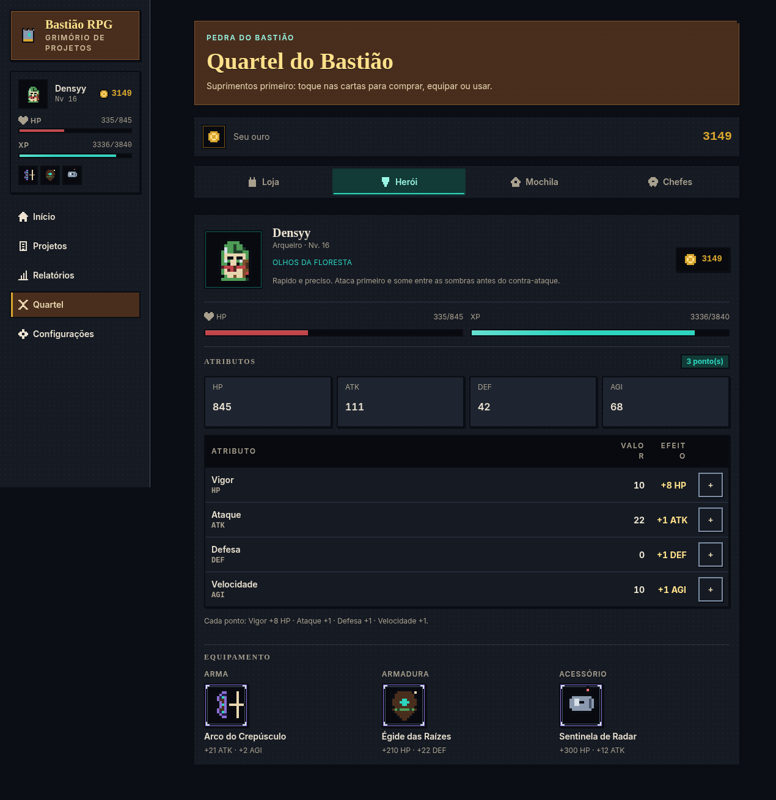
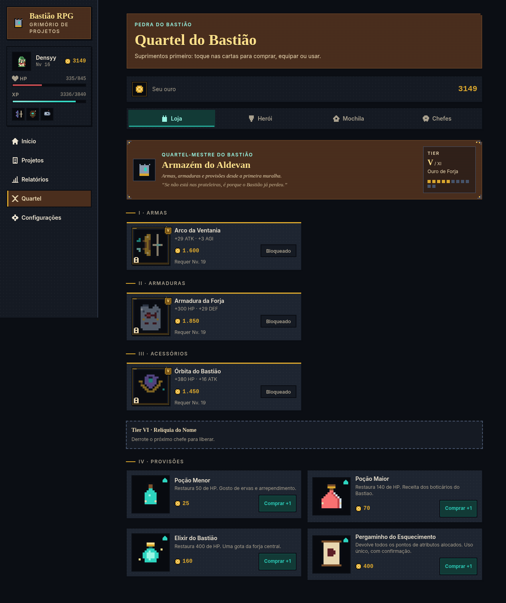
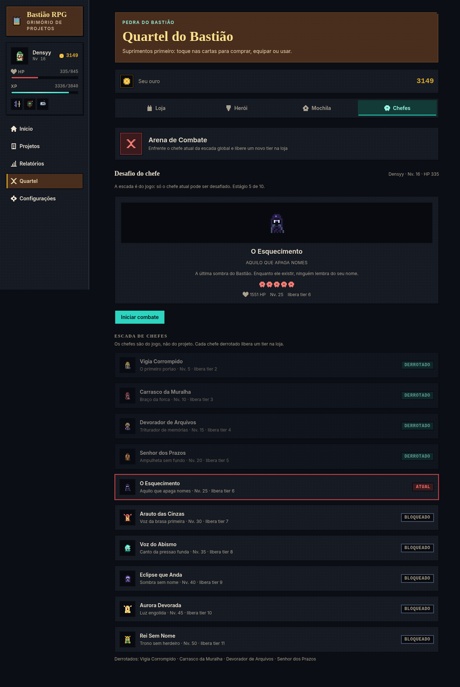
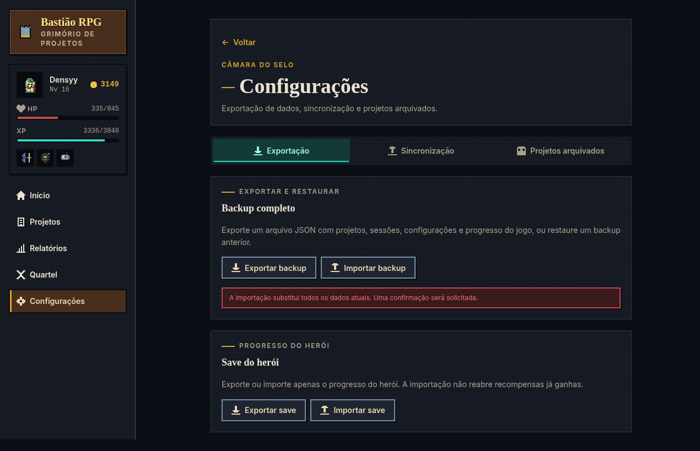

# Bastião RPG

**Acesse em:** https://rpg.densyy.com

## O que é este projeto

Este é um app de produtividade. Ele organiza seus projetos. Você liga um
cronômetro e trabalha. Cada sessão concluída vira progresso em um jogo de RPG.
Você ganha níveis, itens e ouro. O app não pede conta. O app não tem servidor.
Seus dados ficam no seu navegador.

## Qual é o diferencial

Muitos apps pedem uma lista de tarefas. Você organiza tudo antes de começar.
A lista cresce. O trabalho fica para depois. Aqui é diferente. Você diz o que
está fazendo agora. O cronômetro começa na hora. O foco está na ação.

## Benefícios

- Começar fica mais fácil. A sessão inicia na hora.
- O progresso fica visível. As horas e os níveis crescem.
- A recompensa vem rápido. O esforço vira experiência e itens.
- O trabalho fica em blocos curtos. Isso ajuda a concentração.
- A escolha da tarefa some. O app sorteia para você.
- Os dados ficam com você. Não dependem de outra empresa.

## O método aleatório

A procrastinação aparece. Você não sabe por onde começar. O modo aleatório
resolve isso. Um clique e o app sorteia o projeto. Ele também sorteia a
duração. Você só começa.

## Horas e ganhos por projeto

Cada projeto tem um valor por hora. O app soma as sessões concluídas. Ele
mostra o total de horas. Ele calcula o dinheiro. Assim você vê o tempo
investido e o retorno.

## O jogo

O jogo tem 50 níveis. Você começa com um herói. Ele ganha experiência e ouro
a cada sessão concluída.

- Classes: Guerreiro, Mago, Arqueiro e Gatuno.
- Atributos: vida, ataque, defesa, velocidade e chance de crítico.
- Você distribui pontos de atributo quando sobe de nível.
- O Pergaminho do Esquecimento devolve esses pontos para você redistribuir.

## Equipamentos e loja

A loja tem 11 níveis de itens e 66 produtos. Cada nível tem 4 armas, uma para
cada classe, mais 1 armadura e 1 acessório. O Guerreiro usa espadas, machados e
martelos. O Mago usa cajados. O Arqueiro usa arcos. O Gatuno usa adagas e
picaretas. Cada item tem um bônus de atributo. A venda devolve 40% do preço.

## Chefes

São 10 chefes em sequência. Cada vitória libera o próximo nível da loja. A
escada começa no Vigia Corrompido e termina no Rei Sem Nome. No caminho estão
o Carrasco da Muralha, o Devorador de Arquivos, o Senhor dos Prazos, o
Esquecimento, o Arauto das Cinzas, a Voz do Abismo, o Eclipse que Anda e a
Aurora Devorada.

## Combate e poções

O combate é por turnos. A velocidade define quem ataca primeiro. O crítico
multiplica o dano por 1,6. Você pode atacar, usar item ou fugir. As poções
curam vida: a Poção Menor cura 50, a Poção Maior cura 140 e o Elixir do
Bastião cura 400.

## Para onde vão os dados

Os dados ficam no IndexedDB do navegador. Não existe servidor. Não existe conta.
Não existe telemetria. Se você limpar os dados do site, tudo se perde.

## Como fazer backup

Existem duas formas. A primeira é exportar um arquivo JSON na aba de
configurações. O app valida o arquivo antes de importar. A segunda é sincronizar
com o seu Bunny Storage. O app envia o backup a cada hora e a cada level up.
Você também pode enviar na hora.

